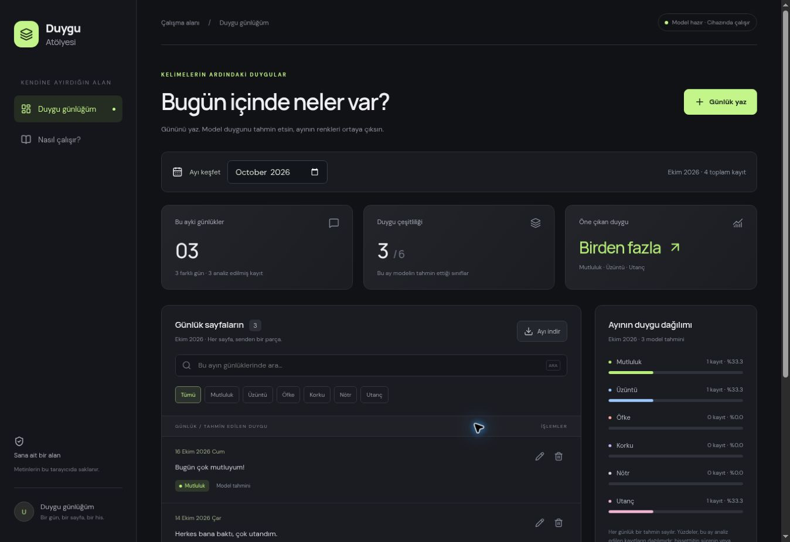

# Duygu Atölyesi — Model Destekli Günlük

Türkçe günlükleri kullanıcının eğittiği Linear SVM modeliyle sınıflandıran ve aylık duygu dağılımını gösteren React uygulaması.

## Kurulum
Node.js 22.13+ ve npm gerekir. Klasörü VS Code ile açıp terminalde:

```sh
npm ci
npm run dev
```
Terminalde gösterilen adresi açın. İlk açılışta yaklaşık 5 MB'lık model dosyası yüklenir. Siteyi çalıştırmak için Python veya API anahtarı gerekmez.

```sh
npm test
npm run typecheck
npm run build
npm run preview
```

`dist/` hazır yayın çıktısıdır. `index.html` dosyasına çift tıklamayın; HTTP sunucusu veya Netlify üzerinden çalıştırın.

## Kullanım
Ay seçin → Günlük yaz → Tarihi ve metni girin → otomatik tahmini görün → Analiz et ve kaydet.
Kalem düğmesi metni/tarihi günceller ve yeniden tahmin yapar. Çöp kutusu onaydan sonra siler. Ayı indir düğmesi seçilen ayı CSV olarak dışa aktarır. Arama ve duygu filtresi listeyi değiştirir; grafik ayın bütün model tahminlerini gösterir.

Her kayıt eşit ağırlıktadır; bir günde birden fazla kayıt olabilir. 10 kaydın 6'sı mutluluk = %60 kayıt payı. Bu, ayın %60'ında mutlu olunduğu veya modelin %60 emin olduğu anlamına gelmez.

## Dosyalar
- Components: duygu etiketi bileşeni
- Pages: günlük CRUD, aylık dağılım ve açıklama ekranı
- Interfaces: veri tipleri
- lib/emotion-engine.mjs: TF-IDF + Linear SVM çıkarımı
- lib/diary.mjs: tarih ve aylık hesap
- public/emotion-model.json: eğitilmiş ağırlıklar
- model/emotion_model.joblib: kullanıcıdan gelen özgün model
- model/emotion_model.ipynb: önceki eğitim notebook'u; eğitim CSV'si sağlanmadı ve pakette yok
- model/export_model.py: yeniden model aktarımı
- tests: Python çıktılarıyla eşitlik ve aylık hesap testleri
- docs: yönerge kontrolü, yayın adımları ve ekran görüntüsü
- dist: Netlify'a yüklenebilen üretim çıktısı

## Gerçek model entegrasyonu
Metin boşlukları notebook'taki gibi düzenlenir. Karakter TF-IDF (char_wb, 3–5 gram, sublinear TF, L2 norm) 38.178 özellik üretir. Kelime/karakter sayıları MaxAbsScaler ile ölçeklenir. LinearSVC karar puanlarının en büyüğü sınıfı belirler. Özgün model yeniden eğitilmedi; ağırlıkları aktarıldı. Karar puanları olasılık değildir.

96 karşılaştırma girdisinde Python ve JavaScript aynı sınıfları verdi; en büyük karar puanı farkı yaklaşık 1.78e-15. Bu **aktarım doğrulamasıdır**, gerçek hayat doğruluğunun %100 olduğu anlamına gelmez. Eğitim CSV'si olmadığı için test başarısı yeniden ölçülmedi.

Model tek duygu seçer; ironi, karma duygular ve uzun günlüklerde hata yapabilir. Tanı aracı değildir.

## Gizlilik ve kayıtlar
Metinler analiz için sunucuya gönderilmez. Günlükler LocalStorage ile aynı tarayıcı profilinde saklanır; cihazlar arasında eşitlenmez ve şifreli hesap kasası değildir. Aynı profili kullanan biri okuyabilir. Tarayıcı verileri temizlenirse kayıtlar kaybolur; CSV yedeği alın. Eski elle etiketlenen kayıtlar korunur; isteğe bağlı yeniden analiz edilmeden grafiğe katılmaz.

## Modeli tekrar dışa aktarma (isteğe bağlı)
Python 3.12 ve ayrı bir sanal ortamla:

```sh
python -m venv .venv
# Windows: .venv\Scripts\activate
# macOS/Linux: source .venv/bin/activate
pip install -r model/requirements.txt
python model/export_model.py
python model/refresh_fixtures.py
npm test
npm run build
```

Joblib dosyası scikit-learn 1.6.1 ile oluşturulmuştur. Yalnızca güvendiğiniz joblib dosyalarını açın. Model mimarisi değişirse çıkarım kodu da uyarlanmalıdır.

GitHub ve Netlify adımları docs/YAYIN_VE_TESLIM.md içinde.


